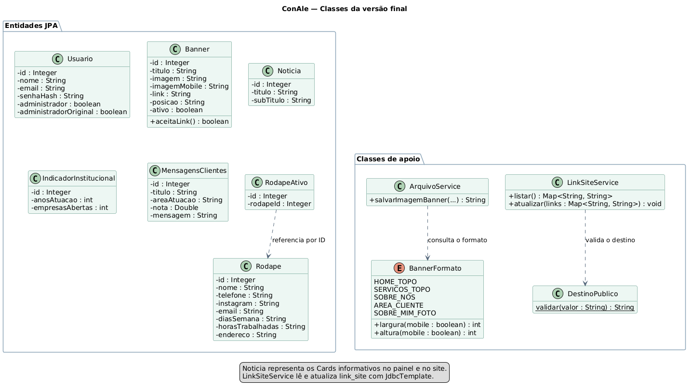
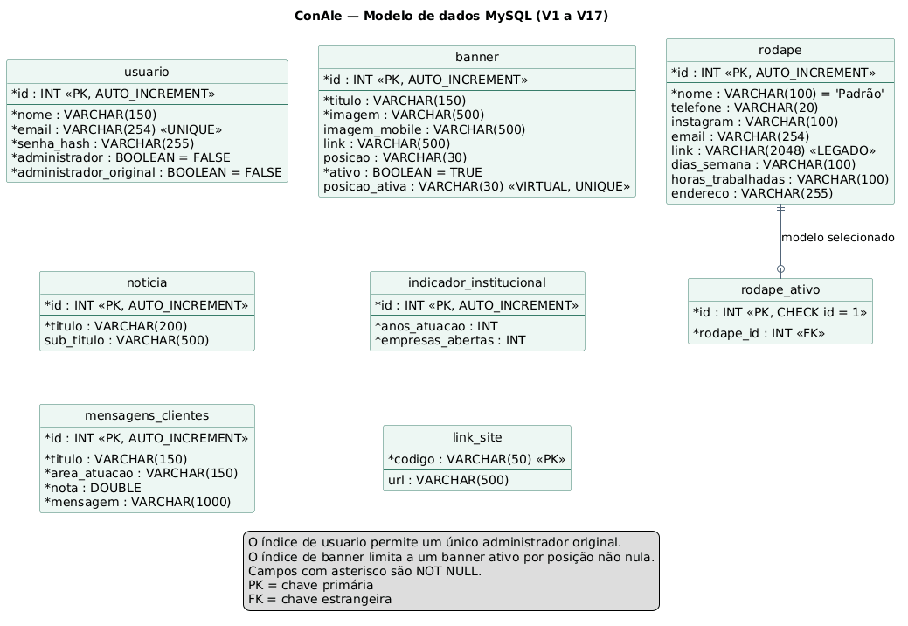
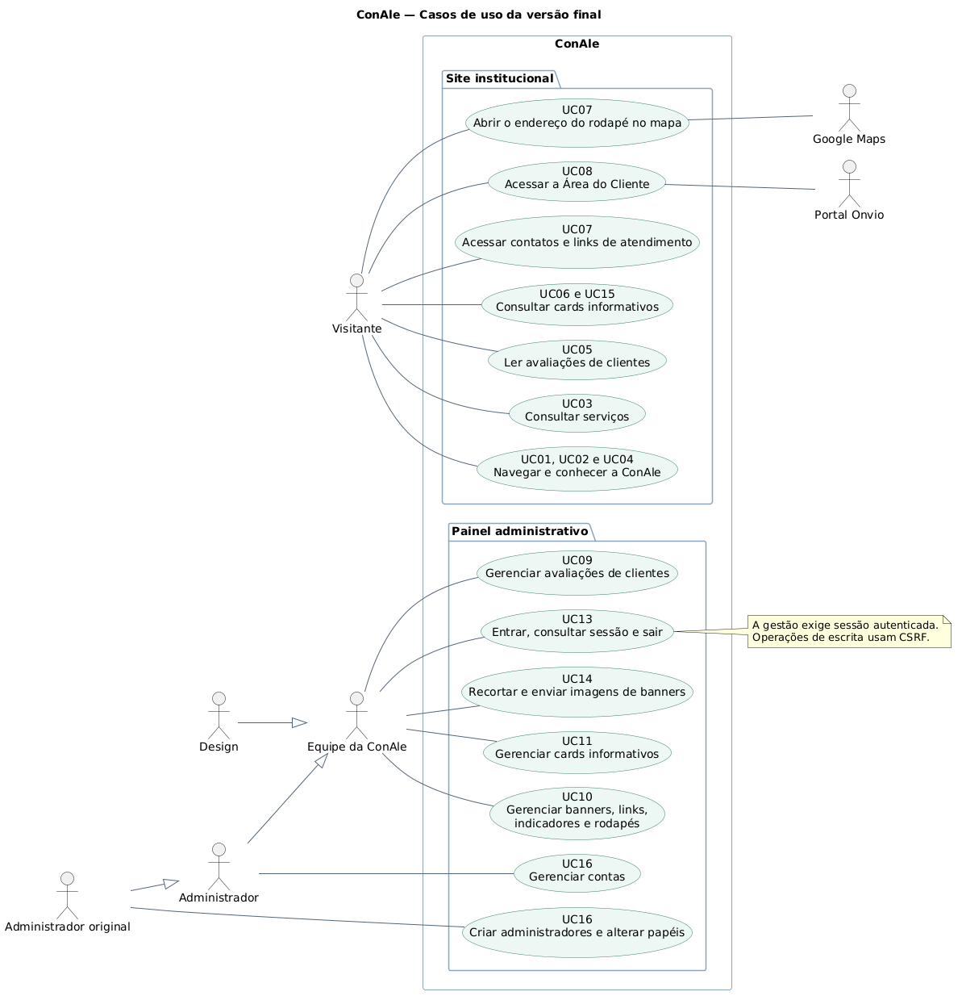

# PRD — ConAle

Versão final da entrega de Laboratório de Programação para a Internet (2026B).

## 1. Objetivo

Apresentar a ConAle e seus serviços contábeis para profissionais e empresas da área da saúde, facilitar o contato e permitir que a equipe atualize conteúdos institucionais pelo painel administrativo.

A solução reúne um site público e um painel de gestão de conteúdo. A Área do Cliente direciona ao portal externo da ConAle.

## 2. Site público

| Página | Rota | Conteúdo e ações |
| --- | --- | --- |
| Home | `/` | Banner principal, cinco atalhos, indicadores, três destaques, apresentação da ConAle, Área do Cliente, diferenciais, resumo dos quatro serviços e carrossel de cards informativos. |
| Serviços | `/servicos` | Banner compartilhado com Dúvidas Frequentes, descrição dos quatro serviços, links de contratação, atalhos compartilhados com a Home, Área do Cliente e carrossel de cards informativos. |
| Sobre Mim | `/sobre` | Apresentação institucional com foto, seção **Nossos Clientes** com as avaliações cadastradas e Área do Cliente. |
| Dúvidas Frequentes | `/duvidas` | Banner compartilhado com Serviços, cards informativos em grade e resumo dos serviços. |

O cabeçalho oferece navegação entre as quatro páginas e um atalho para a Área do Cliente. O mesmo destino atende o cabeçalho e os acessos do corpo da Home, de Serviços e de Sobre Mim. O destino padrão é o Onvio e pode ser alterado em **Banners**, na posição **Área do Cliente**.

O rodapé ativo é compartilhado entre todas as páginas. Ele exibe o telefone, o Instagram, o e-mail, o horário de atendimento e o endereço cadastrados. O Instagram abre o perfil cadastrado em nova aba. E-mail e endereço aparecem como texto. Os botões flutuantes de WhatsApp e e-mail usam o telefone e o e-mail desse cadastro. O WhatsApp abre uma conversa e o e-mail abre uma nova mensagem no serviço configurado no dispositivo.

O endereço do rodapé determina a prévia do mapa e o endereço aberto no Google Maps. O cadastro aceita duas linhas, com rua, número e complemento na primeira e bairro, cidade, UF e CEP na segunda. A área do mapa funciona como link em nova aba e mantém os créditos do Google na base.

## 3. Conteúdo editável e dados iniciais

| Módulo do painel | O que a equipe pode alterar | Exibição no site |
| --- | --- | --- |
| **Banners** | Posição, título, imagem de computador, imagem opcional para celular, link nas posições com botão e estado ativo. | Topo da Home, topo de Serviços e Dúvidas Frequentes, seção Sobre Nós da Home, arte da Área do Cliente e foto de Sobre Mim. |
| **Links do site** | Destinos dos cinco atalhos, dos três destaques e dos quatro serviços. | Os atalhos são compartilhados por Home e Serviços. Os destinos dos serviços são compartilhados entre o resumo e os botões da página Serviços. |
| **Indicadores** | Anos de atuação e quantidade de empresas abertas, com valores inteiros a partir de zero. | A Home exibe o registro mais recente. |
| **Cards informativos** | Título obrigatório de até 200 caracteres e subtítulo opcional de até 500 caracteres. | A mesma lista da API aparece em carrossel na Home e em Serviços e em grade em Dúvidas Frequentes. |
| **Rodapé** | Modelos com nome interno, telefone, Instagram, e-mail, horários e endereço. A equipe escolhe o modelo ativo. | Um modelo ativo por vez, usado em todas as páginas e nos contatos flutuantes. |
| **Avaliação de clientes** | Nome exibido, área de atuação, nota de 0 a 5 e depoimento. | Seção **Nossos Clientes** de Sobre Mim. |

Os textos de apresentação, as descrições dos serviços, os diferenciais e as imagens dos três destaques fazem parte do frontend. O painel configura os destinos desses destaques e serviços.

Uma instalação com banco vazio recebe cinco banners, seis cards informativos, um rodapé **Padrão** ativo, cinco avaliações e um registro com **0 anos de atuação** e **0 empresas abertas**. Os 12 campos de **Links do site** começam sem destino personalizado.

Em **Links do site**, são aceitas URLs absolutas com HTTP ou HTTPS, caminhos das páginas públicas e âncoras existentes, como `/duvidas#faq`. Um campo vazio deixa o destino sob a regra padrão do componente. Sem configuração, os cinco atalhos ficam desativados, os destaques apontam para a seção de serviços, o resumo dos serviços mantém seus textos e os botões de contratação ficam desativados.

## 4. Banners e mídia

Pode haver um banner ativo por posição. Para ativar outro, a equipe primeiro desativa o anterior ou edita o banner em uso. A foto de **Sobre Mim** é a posição sem campo de link. Se a imagem de celular estiver vazia, o site usa a imagem de computador.

| Posição | Computador | Celular |
| --- | --- | --- |
| Topo da Home | 1923 × 699 px | 375 × 360 px |
| Topo de Serviços e Dúvidas Frequentes | 1923 × 699 px | 383 × 332 px |
| Sobre Nós | 572 × 320 px | 576 × 300 px |
| Área do Cliente | 684 × 220 px | 576 × 324 px |
| Foto da página Sobre Mim | 491 × 574 px | 255 × 283 px |

As dimensões da tabela são as referências do recorte. O painel oferece prévia, ajuste de enquadramento e zoom. O upload aceita JPEG e PNG de até 5 MB. A API confere o conteúdo do arquivo, a proporção e a resolução mínima conforme a posição. Cada arquivo enviado é salvo com nome gerado pelo servidor no volume Docker de uploads. O banco guarda o caminho da imagem associado ao banner. As imagens padrão são distribuídas com o frontend.

## 5. Autenticação, permissões e navegação do painel

O painel fica em `/admin` e o acesso começa em `/admin/login`. A API valida as permissões e a interface exibe as opções correspondentes à conta autenticada.

| Perfil | Permissões |
| --- | --- |
| **Design** | Acessar o painel e gerenciar banners, links, indicadores, cards informativos, rodapés e avaliações. |
| **Administrador** | Gerenciar todo o conteúdo e acessar o módulo **Usuários**, respeitando as regras de atribuição de papéis. |
| **Administrador original** | Exercer as permissões de Administrador, atribuir o papel de Administrador a novas contas e mudar o papel de outras contas. Somente ele pode editar sua própria conta, cujo papel é fixo e cuja exclusão é bloqueada. |

O login usa e-mail e senha, com hash BCrypt no banco. O servidor troca o identificador da sessão no login. A sessão usa o cookie `JSESSIONID`, com HttpOnly e SameSite=Strict, e expira após 30 minutos de inatividade. O backend exige um token CSRF válido nas requisições de gravação e no logout. Reiniciar o backend encerra as sessões em memória.

O botão **Voltar** aparece nos formulários de cadastro e edição. Ele encerra o formulário e retorna à listagem da seção sem salvar alterações. Em **Rodapé**, os formulários **Novo rodapé** e **Editar rodapé** voltam à lista de modelos na mesma página. O menu lateral é a navegação entre seções e o Dashboard.

## 6. Requisitos funcionais da entrega

Os identificadores foram preservados para relacionar esta entrega ao PRD inicial.

| ID | Requisito |
| --- | --- |
| RF01–RF03 | Apresentar a Home, a especialização em contabilidade para a área da saúde e a navegação entre páginas e seções. |
| RF04–RF05 | Apresentar a ConAle, sua experiência e seus diferenciais por meio dos textos, imagens e indicadores institucionais. |
| RF06 | Apresentar Contabilidade, BPO Financeiro, Mentoria Financeira e Soluções Complementares, com destinos configuráveis. |
| RF07 | Exibir as avaliações cadastradas em Sobre Mim. |
| RF08 | Exibir os cards compartilhados, em carrossel na Home e em Serviços e em grade em Dúvidas Frequentes. |
| RF09–RF11 | Exibir contatos e endereço, oferecer os atalhos de WhatsApp e e-mail e encaminhar a intenção de contratação pelos links cadastrados. |
| RF12 | Direcionar a Área do Cliente ao portal externo. |
| RF13 | Reservar o painel para contas autorizadas da equipe da ConAle. |
| RF14 | Permitir gerenciar os conteúdos e destinos definidos na seção 3. |
| RF15 | Gerenciar avaliações de clientes com nome exibido, área, nota e depoimento. |
| RF16 | Cadastrar, consultar, editar e excluir cards informativos com título e subtítulo. |
| RF17 | Chatbot. Item fora do escopo da entrega. |
| RF18 | Permitir login, consulta da sessão e logout, com autorização de operações no servidor. |
| RF19 | Enviar e associar imagens aos banners, com proporções por posição e validação no servidor. |
| RF20 | Exibir os dados salvos dos cards nas páginas públicas na próxima consulta à API. |
| RF21 | Cadastrar, editar, ativar e excluir modelos de rodapé. A exclusão do modelo ativo exige a ativação de outro. |
| RF22 | Gerenciar contas pelo painel de acordo com as permissões de cada perfil. |

O produto cobre apresentação institucional, publicação de conteúdo e redirecionamento para canais externos. Ficam fora do escopo a gestão contábil, a emissão de guias, o login público de clientes, o processamento de pagamentos, o chatbot e a publicação de artigos com fluxo editorial.

## 7. Arquitetura e modelo de dados

O frontend em React e TypeScript consulta a API pública e envia as alterações do painel à API Spring Boot. A API aplica validação e permissões, grava o conteúdo no MySQL e salva as imagens enviadas em disco. No ambiente publicado, o Nginx serve o frontend e encaminha as requisições para a API e os uploads. Banco e arquivos enviados têm volumes Docker próprios.

| Tabela | Responsabilidade |
| --- | --- |
| `usuario` | Contas da equipe, credenciais protegidas por hash e indicadores de Administrador e Administrador original. |
| `banner` | Banners por posição, com título, caminhos das imagens de computador e celular, link e estado ativo. |
| `noticia` | Cards informativos com ID, título e subtítulo. O nome da tabela e da API conserva a nomenclatura técnica original. |
| `indicador_institucional` | Anos de atuação e quantidade de empresas abertas. |
| `mensagens_clientes` | Avaliações com nome exibido, área, nota e mensagem. |
| `rodape` | Modelos de rodapé com nome interno, contatos, horários e endereço. |
| `rodape_ativo` | Registro único com a referência ao rodapé publicado. |
| `link_site` | Destinos configuráveis do site, identificados por código. |

A tabela `rodape_ativo` referencia o modelo publicado por chave estrangeira. Banners guardam caminhos de mídia. O Flyway aplica a estrutura e os dados iniciais pelas migrations V1 a V17.

### Diagrama de classes

[Fonte PlantUML do diagrama de classes](diagrama_de_classes.puml)

### Modelo de dados

[Fonte PlantUML do modelo de dados](modelo_de_dados.puml)

## 8. Casos de uso

| Caso | Ator e ação |
| --- | --- |
| UC01–UC06 | Visitante consulta a Home, navega, conhece os serviços e diferenciais, e lê as avaliações e dúvidas frequentes. |
| UC07–UC08 | Visitante usa os canais de contato ou abre a Área do Cliente. |
| UC09–UC11 | Administrador ou Design gerencia avaliações, conteúdo institucional e cards informativos. |
| UC12 | Chatbot. Item fora do escopo da entrega. |
| UC13–UC14 | Administrador ou Design entra no painel, encerra a sessão e envia imagens para os banners. |
| UC15 | Visitante lê os cards informativos publicados no site. |
| UC16 | Administrador gerencia contas, dentro das permissões da seção 5. |

[Fonte PlantUML do diagrama de casos de uso](diagrama_de_casos_de_uso.puml)

## 9. Verificação da entrega

| Fluxo | Critério de aceitação |
| --- | --- |
| Site público | Navegar pelas quatro páginas em computador e celular, conferir imagens responsivas, cards, contatos e destinos configurados. |
| Acesso | Testar login, logout, sessão e bloqueio do módulo Usuários para Design. |
| Conteúdo | Salvar links, cards, indicadores e avaliações. Consultar as páginas correspondentes para verificar os dados publicados. |
| Banners | Recortar e enviar uma imagem válida, salvar o banner e conferir a versão exibida por tamanho de tela. A API deve recusar um segundo banner ativo na mesma posição. |
| Rodapé | Ativar um modelo, conferir contatos e endereço nas páginas e verificar se a prévia abre o mesmo endereço no Google Maps. |
| Retorno à lista | Abrir um formulário de cadastro ou edição, acionar **Voltar** e verificar o retorno à listagem sem gravação. |
| Acessibilidade | Conferir a navegação por teclado, os rótulos dos formulários, as mensagens de validação e o foco do link do mapa. |
| Persistência | Manter os registros e as imagens enviados ao recriar containers com os mesmos volumes. |

Os comandos de execução e teste, a configuração de implantação e a referência da API estão no [README do projeto](../../README.md). O [guia de autenticação e Postman](../autenticacao-postman.md) detalha a verificação pela API.
